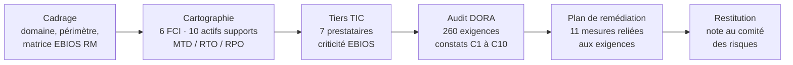

# Audit de conformité DORA — cas d'étude « Banque Ardelle »

> Audit complet de conformité au règlement européen **DORA** (UE 2022/2554), mené de bout en bout dans l'outil GRC open source **CISO Assistant** : cadrage, cartographie, évaluation de 260 exigences, plan de remédiation chiffré et note de synthèse pour un comité des risques.

**English summary** — End-to-end DORA compliance audit of a fictional French retail bank, run in CISO Assistant (self-hosted, Docker). 260 requirements assessed, 29 major non-conformities identified, 11-measure remediation plan costed at €320k, and a two-page board-level memo.

⚠️ La Banque Ardelle est une **entreprise fictive**, créée pour un exercice de montée en compétence. Les exigences, la méthode et les livrables sont ceux d'une mission réelle ; les constats, prestataires et montants sont inventés.

---

## Le contexte

| Élément | Valeur |
| --- | --- |
| Entité | Banque régionale de détail, Lyon : 1 800 salariés, 900 000 clients, PNB 610 M€ |
| Autorité | ACPR, contrôle sur place annoncé au 2e trimestre 2027 |
| Demande | État des lieux DORA et plan d'action chiffré sous 3 mois |
| Périmètre | 6 fonctions critiques ou importantes (FCI), 10 actifs supports, 7 prestataires TIC |
| Référentiel | Règlement (UE) 2022/2554, bibliothèque officielle CISO Assistant |

## La démarche

1. **Cadrage** : création du domaine et du périmètre, chargement de la bibliothèque DORA et de la matrice de risques 4×4 EBIOS RM.
2. **Cartographie** : saisie des 6 FCI avec leurs objectifs de reprise (MTD, RTO, RPO), cibles de sécurité (DICP) et champs du registre d'informations DORA ; rattachement des actifs supports par leurs dépendances.
3. **Prestataires TIC** : 7 tiers qualifiés par niveau métier et par criticité EBIOS RM (dépendance × pénétration ÷ maturité × confiance).
4. **Audit** : évaluation des 260 exigences, chaque conclusion justifiée par un constat ; gravité qualifiée selon la nomenclature ISO (non-conformité majeure ou mineure, point sensible, piste d'amélioration).
5. **Plan de remédiation** : 11 mesures traitant chacune une cause racine, avec priorité, effort, impact, échéance, coûts de build et de run, puis reliées aux exigences qu'elles couvrent.
6. **Restitution** : exports de l'outil et note de deux pages pour le directoire.

## Les résultats

| Pilier DORA | Évaluées | Conformes | Partielles | Non conformes | dont majeures |
| --- | --- | --- | --- | --- | --- |
| II – Gestion du risque TIC | 46 | 4 | 25 | 17 | 15 |
| III – Incidents TIC | 12 | 0 | 2 | 10 | 5 |
| IV – Tests de résilience | 4 | 0 | 3 | 1 | 1 |
| V – Prestataires TIC | 33 | 0 | 12 | 21 | 8 |
| **Total** | **95** | **4** | **42** | **49** | **29** |

Sur 260 exigences : 64 non applicables (obligations des autorités ou d'autres types d'entités), 101 non évaluées faute de preuve, déclarées comme limites de l'audit.

**Les cinq causes racines** : gouvernance du risque TIC défaillante (politique non approuvée, RSSI non indépendant) ; absence de stratégie de sortie pour le core banking ; classification et notification des incidents non alignées sur DORA ; sauvegardes non isolées ; registre d'informations incomplet.

**Le plan** : 11 mesures en 4 lots, 320 k€ d'investissement et 400 jours-homme, puis 68 k€ par an, soit environ 0,05 % du PNB.

## Les livrables

| Fichier | Contenu | Pour qui |
| --- | --- | --- |
| [`livrables/01-etat-de-conformite-DORA.pdf`](livrables/01-etat-de-conformite-DORA.pdf) | Rapport d'audit complet, exigence par exigence | L'audité, l'autorité |
| [`livrables/02-synthese-executive.docx`](livrables/02-synthese-executive.docx) | Couverture, radar et scores par chapitre | La direction |
| [`livrables/03-plan-d-action.pdf`](livrables/03-plan-d-action.pdf) | Les 11 mesures triées par échéance | Le comité de pilotage |
| [`livrables/04-note-comite-des-risques.pdf`](livrables/04-note-comite-des-risques.pdf) | Note de deux pages : constats, budget, décisions attendues | Le directoire |
| [`livrables/05-classeur-audit-260-exigences.xlsx`](livrables/05-classeur-audit-260-exigences.xlsx) | Données brutes de l'audit | L'auditeur |
| [`cadrage/cas-etude-banque-ardelle.md`](cadrage/cas-etude-banque-ardelle.md) | Énoncé du cas, grilles de saisie et notes méthodologiques | Comprendre la démarche |
| [`cadrage/installation-lab.md`](cadrage/installation-lab.md) | Installation de CISO Assistant et exploitation courante | Reproduire le lab |

## Compétences démontrées

- **Réglementation** : DORA (gouvernance, incidents, tests, prestataires tiers, registre d'informations), articulation avec NIS2 et ISO 27001.
- **Audit** : lecture exigence par exigence, conclusions fondées sur la preuve, gestion du « non évalué » et du « non applicable », qualification de la gravité.
- **Continuité** : FCI, BIA, MTD / RTO / RPO, stratégies de sortie, risque de concentration.
- **Risque des tiers** : qualification des prestataires, criticité EBIOS RM, clauses contractuelles de l'article 30.
- **Pilotage** : plan de remédiation par causes racines, priorisation impact × effort, chemin critique, chiffrage build / run.
- **Restitution** : adaptation du livrable au lecteur, du rapport détaillé à la note au directoire.
- **Outillage** : CISO Assistant auto-hébergé (Docker, Ubuntu, VMware).

## Limites et suite

- Audit fondé sur des constats d'entretiens fictifs ; aucun test technique.
- Règlement seul, sans les normes techniques déléguées (RTS et ITS).
- Prochaine étape : analyse de risques EBIOS RM complète (ateliers 1 à 5) sur le même périmètre.

## Auteur

**Kennedy** — Master 2 Cybersécurité & Data Science (ISFA, Université Lyon 1), PMP, environ 6 ans en gestion de projets IT et cybersécurité.
